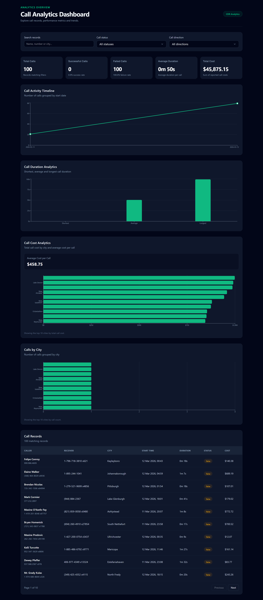
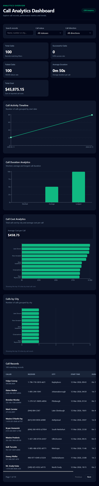
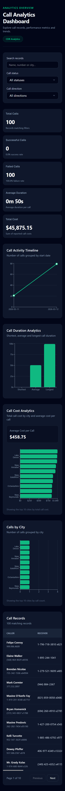

# 📊 Call Analytics Dashboard

🔗 [Vercel Live Demo](https://call-analytics-dashboard-xi.vercel.app/)

A responsive telecom call-detail-record (CDR) analytics dashboard built with React, TypeScript, Vite, and Tailwind CSS. The application integrates with a custom FastAPI backend backed by PostgreSQL and requires JWT authentication to access call analytics.

<details>
<summary>📸 Screenshots</summary>

<br>

## 🖥️ Desktop preview



<table width="100%">
  <thead>
    <tr>
      <th style="text-align: center;">📱 Tablet</th>
      <th style="text-align: center;">📱 Mobile</th>
    </tr>
  </thead>
  <tbody>
    <tr>
      <td width="50%" style="vertical-align: top;"></td>
      <td width="50%"></td>
    </tr>
  </tbody>
</table>
</details>

## Features

- ✅ **JWT login:** sign-in form and authenticated requests to protected backend endpoints.
- ✅ **Five KPI cards:** total calls, successful calls, failed calls, average call duration, and total call cost (USD).
- ✅ **Call Activity Timeline:** number of calls grouped by start date.
- ✅ **Call Duration Analytics:** shortest, average, and longest call durations.
- ✅ **Call Cost Analytics:** total call cost by city (top 10) and average cost per call.
- ✅ **Calls by City:** call counts by city (top 10).
- ✅ **Call Records:** searchable, filterable, paginated table with call details and USD-formatted costs.
- ✅ **Data states:** loading, error handling, and retry functionality.
- ✅ **Responsive design:** desktop, tablet, and mobile layouts, including horizontal scrolling for the call records table on smaller screens.

The dashboard metrics and charts update based on active search and filters. The backend database contains 10,000 imported CDR records; the deployed dashboard has also been verified to load them through the production API.

## Tech stack

- React 19 and TypeScript
- Vite
- Tailwind CSS 4
- shadcn/ui components
- Recharts
- FastAPI REST backend with JWT authentication
- PostgreSQL (Neon) through the backend

## Demo accounts

The following accounts are provided for evaluating the **demo application only**. The dataset is synthetic/sample CDR data. Do not reuse these credentials for other services.

| Role | Email | Password |
| --- | --- | --- |
| Admin | `admin@example.com` | `qazwsxedcrfv123` |
| Analyst | `analyst@example.com` | `tgbyhnujmik,123` |

To test the application, open the [live dashboard](https://call-analytics-dashboard-xi.vercel.app/), sign in with either account, and explore the analytics and call records. The API requires a bearer token for protected endpoints. **These are publicly documented demo credentials; rotate or disable them before connecting real or sensitive data.**

## Getting started

### Prerequisites

- Node.js and npm compatible with the Vite version specified in `package.json`
- Running [Call Analytics Backend](https://github.com/ralitsavoronevska/call-analytics-backend) with a configured PostgreSQL database and an existing user account

### Install and run

```bash
npm ci
```

Create `.env.local` in the frontend project root:

```dotenv
VITE_API_BASE_URL=http://127.0.0.1:8000
```

Then run:

```bash
npm run dev
```

Open the local URL displayed by Vite (usually `http://localhost:5173/`) and sign in using an account provisioned in the backend. **Do not commit credentials or secrets.** Values prefixed with `VITE_` are embedded in the frontend build and must not contain secrets.

### Quality checks and production build

```bash
npm run lint
npx tsc --noEmit -p tsconfig.app.json
npm run build
npm run preview
```

The production build is generated in `dist/`.

## API integration and authentication

- `src/services/auth.service.ts` sends credentials to `POST /api/auth/login` and receives a JWT access token.
- `src/services/cdr.service.ts` retrieves protected CDR records and maps API responses for the dashboard.
- `src/hooks/useCallRecords.ts` manages loading, errors, cancellation, and retries.
- Protected requests include an `Authorization: Bearer <token>` header.
- The JWT is kept in React application state; a page reload requires signing in again.

The API base URL is configured through `VITE_API_BASE_URL`. Both service modules strip trailing slashes from this value before appending API paths, preventing accidental `//api/...` URLs. The backend must be accessible from the browser and permit the frontend origin via CORS.

## Deployment

The frontend is deployed on Vercel:

**Live Demo:** [Call Analytics Dashboard](https://call-analytics-dashboard-xi.vercel.app/)

The production `VITE_API_BASE_URL` points to `https://call-analytics-backend-o2lz.onrender.com`.

**Production verification (October 28, 2026):** the Render health endpoint and Swagger login returned `200 OK`. Login through the public Vercel frontend succeeded, and the dashboard loaded 10,000 call records from the protected FastAPI endpoints backed by Neon PostgreSQL. The original Render hostname without the `-o2lz` suffix is not the active service URL.

**API documentation:** https://call-analytics-backend-o2lz.onrender.com/docs

Backend repository: https://github.com/ralitsavoronevska/call-analytics-backend

## Notes

Call costs are displayed in USD as specified in the assignment. The dashboard visualizes records returned by the configured API; metrics depend on the underlying dataset.

## 🌟 Inspiration & Credits

- 🪄 [ChatGPT](https://chatgpt.com/)
- 🎨 [Shadcn Admin Free React Theme](https://www.shadcn.io/template/satnaing-shadcn-admin)

---

🙌 Thank you for checking out my project! More is coming 🔜.
Stay tuned 🚀 and please don't forget to give the project a star! ⭐
Made with lots of 💗, ☕, and a sprinkle of ✨ by Ralitsa Voronevska!
